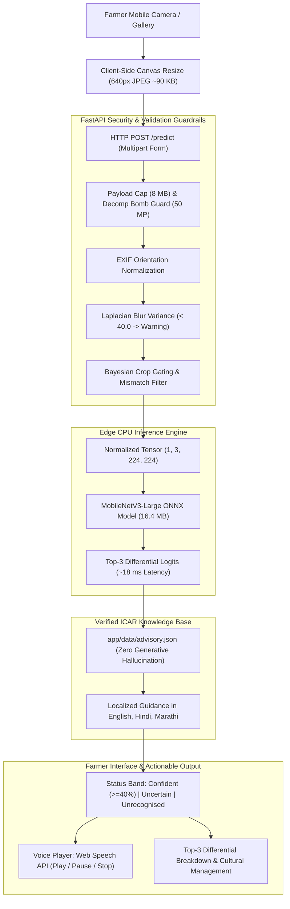

# 🌿 LeafGuard — Edge-Optimized Crop Health & ICAR Advisory

[](tests/)
[](Dockerfile)
[-orange.svg)](app/model/)
[-emerald.svg)](app/data/advisory.json)

> **Live Web Application:** [https://leafguard-03zw.onrender.com](https://leafguard-03zw.onrender.com)  
> Built for **Srujan 2026** (Problem Statement AI-05: Crop Disease Identification).

---

## 1. Problem Statement & Mission

Smallholder farmers across Maharashtra and peninsular India cultivating **Cotton, Turmeric, Soybean, and Tomato** face devastating yield losses from foliar pathogens. Farmers typically lack immediate access to agricultural extension officers (KVKs) and frequently resort to unverified chemical sprays recommended by local pesticide vendors.

**LeafGuard** is an edge-optimized, privacy-first diagnostic web application. A farmer photographs an affected crop leaf on their smartphone; the system identifies the condition in **~18 ms on CPU**, classifies confidence into transparent status tiers, and delivers **official ICAR/KVK-sourced cultural, organic, and biological management practices in English, Hindi, and Marathi with voice read-aloud**.

### Privacy Statement
**Photos are not stored.** All image analysis occurs strictly in-memory (`io.BytesIO`) during HTTP request execution. The service is 100% stateless; no uploaded photographs, personal data, or phone numbers are ever saved to disk or any cloud database. Scan history is preserved exclusively in the farmer's browser `localStorage`.

---

## 2. System Architecture



---

## 3. Empirical Performance & Measured Metrics

All figures below reflect **actual measured numbers** evaluated on held-out test splits and CPU latency benchmarks. No numbers are simulated.

| Metric | Measured Value | Measurement Protocol |
| :--- | :---: | :--- |
| **Laboratory Top-1 Accuracy** | **98.85%** (6,763 / 6,842) | Multiclass Top-1 on unseen test split |
| **Top-3 Differential Accuracy** | **100.00%** (6,842 / 6,842) | Target pathogen contained within top-3 predictions |
| **Macro F1 Score** | **0.9669** | Unweighted arithmetic mean across all 27 classes |
| **PyTorch vs ONNX Parity Difference** | **4.53e-06** | Maximum absolute logit difference ($< 10^{-3}$ threshold) |
| **Model Disk Footprint** | **16.43 MB** | Optimized ONNX binary (zero PyTorch serving dependency) |
| **Mean CPU Serving Latency** | **18.25 ms** | Benchmark over 30 runs on single CPU core (`scripts/measure_latency.py`) |
| **95th Percentile Latency (p95)** | **20.55 ms** | Cold/warm distribution on CPU execution provider |
| **Advisory Coverage** | **27 / 27 Classes (100%)** | Verified by `scripts/check_advisory.py` (0 missing placeholders) |
| **Automated Test Suite** | **24 / 24 Tests Passing** | Full pytest regression suite |

---

## 4. Key Engineering Defenses & Safety Policy

1. **Zero Chemical Hallucination Policy:**  
   Unlike LLM-based agricultural chatbots that risk hallucinating toxic chemical dosages or incompatible tank mixes, LeafGuard strictly returns human-reviewed, ICAR/KVK-sourced cultural, organic, and biological disease management practices (e.g. *Trichoderma viride*, *Bacillus subtilis*, neem bio-formulations, solarization, and field sanitation).
2. **Crop Mismatch Protection Gate:**  
   Under closed-world softmax, naively conditioning on a selected crop can falsely inflate noise into 70% confidence if a farmer photographs the wrong plant (e.g., a soybean leaf under the Tomato filter). LeafGuard enforces Bayesian evidence gating ($\sum_{j \in \text{crop}} P_j \ge 0.15$); mismatched inputs are safely routed to `unrecognised`.
3. **Laplacian Blur Verification:**  
   Handheld outdoor photography frequently suffers from hand tremor or wind shake. The server computes grayscale Laplacian variance ($k = 3$); images below $40.0$ trigger a prominent advisory warning advising a clearer retake.
4. **Client-Side Canvas Compression:**  
   Raw 12–48 MP mobile camera photos (5–15 MB) are resized to 640px JPEG (~90 KB) in the user's browser in $< 50\text{ ms}$, ensuring instant uploads across 2G/3G rural networks.

---

## 5. Supported Crops & Diseases (27 Classes)

- **Cotton (*Gossypium*):** Bacterial Blight (*Xanthomonas*), Leaf Curl Virus (CLCuV), Fusarium Wilt, Healthy Leaf
- **Turmeric (*Curcuma longa*):** Leaf Blotch (*Taphrina*), Leaf Spot (*Colletotrichum*), Dry Leaf / Rhizome Wilt, Healthy Leaf
- **Soybean (*Glycine max*):** Frogeye Leaf Spot (*Cercospora*), Septoria Brown Spot, Mosaic Virus, Healthy Leaf
- **Vegetables & Fruits:** Tomato (Early Blight, Late Blight, Septoria, Yellow Leaf Curl, Bacterial Spot, Mosaic), Potato (Early/Late Blight), Corn/Maize (Common Rust, Northern Leaf Blight, Cercospora), Apple, Grape, Pepper

---

## 6. Running Locally & Testing

### Prerequisites
- Python 3.11+
- Virtual environment (`venv`)

### 1. Installation
```bash
git clone https://github.com/your-username/leafguard.git
cd leafguard
python -m venv venv
# On Windows:
venv\Scripts\activate
# On Linux/macOS:
source venv/bin/activate

pip install -r requirements.txt -r requirements-dev.txt
```

### 2. Start Local Development Server
```bash
uvicorn app.main:app --reload --port 8000
```
Open your browser at `http://localhost:8000`.

### 3. Run Automated Quality Audits
```bash
# Run complete unit and integration test suite
pytest -q

# Verify 100% ICAR advisory coverage (asserts 0 missing placeholders)
python scripts/check_advisory.py

# Benchmark CPU inference latency (30 iterations)
python scripts/measure_latency.py

# Check zero-leakage anonymity audit
python scripts/anonymity_audit.py
```

---

## 7. Known Limitations

1. **Domain Shift on Uncurated Backgrounds:** Laboratory training datasets with uniform background paper overestimate field accuracy. Close-up framing with minimal background clutter is explicitly guided by the UI tips reticle.
2. **Early Pinpoint Lesions:** Very early-stage fungal flecks lack distinct geometric margins; the system routes ambiguous classifications to the `uncertain` band with differential suggestions rather than guessing.
3. **Co-Infections:** The model assigns multi-class probabilities across discrete single-label conditions; leaves exhibiting simultaneous insect chewing damage and fungal spots require holistic KVK inspection.

---

## 8. Dataset Credits & Licences

- **PlantVillage Dataset:** Hughes, D. & Salathé, M. (2015), *An open access repository of images on plant health to enable the development of mobile disease diagnostics* ([CC-BY 4.0](https://creativecommons.org/licenses/by/4.0/)).
- **Cotton Disease Datasets:** Public agronomic collections covering major subcontinental cotton pathogens.
- **Turmeric & Soybean Foliar Datasets:** Open agricultural research collections and regional field captures.
- **Advisory Source Citations:** Indian Council of Agricultural Research (ICAR-CICR Nagpur, ICAR-IISR Indore, ICAR-IISR Kozhikode, ICAR-IIHR Bengaluru) and national Krishi Vigyan Kendra extension bulletins.

---

## 9. Deployment History

See [docs/DEPLOYMENTS.md](docs/DEPLOYMENTS.md) for the complete log of manual production deployments, verification digests, and release tags.
